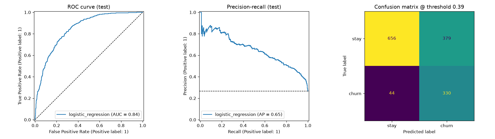
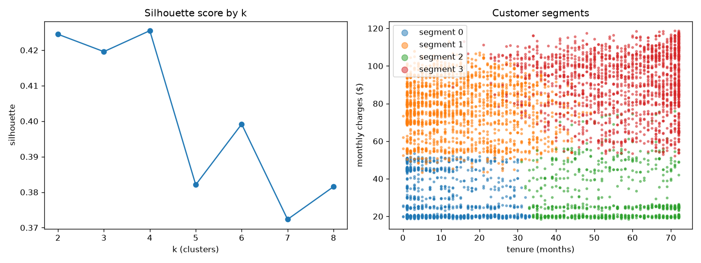
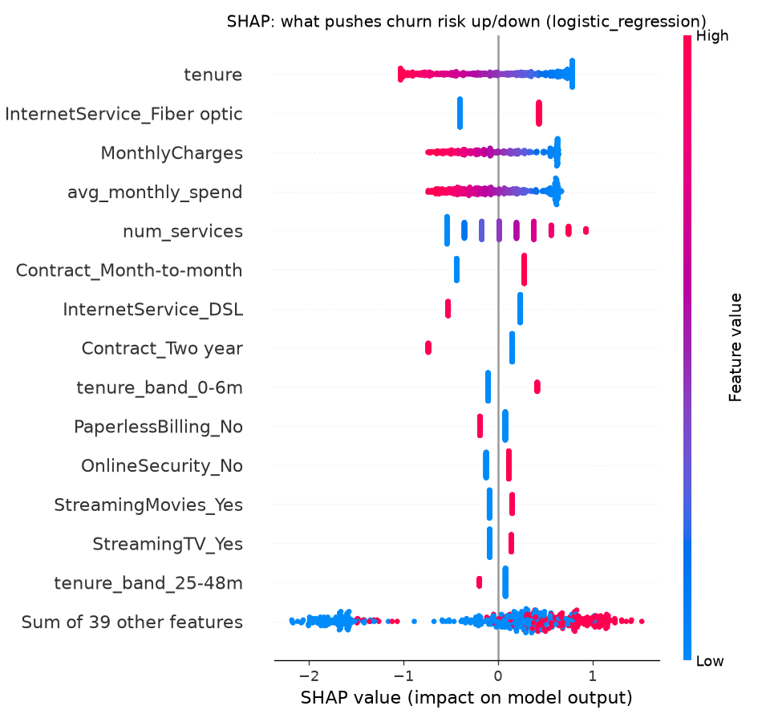

# Customer Churn Prediction & Segmentation

[](https://github.com/HunaizaK/customer-churn-ml/actions/workflows/ci.yml)


[](LICENSE)

End-to-end churn system for a telecom provider: customer segmentation, a cross-validated comparison
of four classifiers, a **cost-based decision threshold**, SHAP explanations, slice-level error analysis,
and a FastAPI service for real-time scoring.

| | |
|---|---|
| **Test ROC-AUC** | **0.845** (logistic regression, held-out 20%) |
| **Churners caught** | **88%** recall at the cost-optimal threshold |
| **Business cost** | **−10%** vs. the default 0.5 threshold |
| **Full pipeline** | ~40 s on a laptop CPU |

---

## Problem

A telecom provider loses ~26% of its customers. A retention offer is cheap; a lost customer is
expensive. The business needs to know **who is about to churn, why, and which groups the model
cannot be trusted on**, so the retention team can act on a ranked list.

## Dataset

[IBM Telco Customer Churn](https://github.com/IBM/telco-customer-churn-on-icp4d): 7,043 customers,
19 features (demographics, services, contract, billing) and a binary `Churn` label.
The file is downloaded by script and verified with a SHA-256 checksum, so every run sees identical data.

## Approach

```
                ┌──────────────┐
 download ─────►│ clean +      │  TotalCharges blank for tenure=0 → 0 (not imputed)
 (sha256)       │ validate     │  schema / null / range checks fail loudly
                └──────┬───────┘
                       │ stratified 80/20 split (seed 42)
          ┌────────────┴─────────────┐
          ▼                          ▼
 ┌─────────────────┐       ┌────────────────────────────────────────────────┐
 │ k-means         │       │ sklearn Pipeline                               │
 │ segmentation    │       │  FeatureBuilder → ColumnTransformer → model    │
 │ (k by silhouette│       │  (same object used in CV, test, and the API)   │
 └────────┬────────┘       └───────────────────────┬────────────────────────┘
          │                                        │ 5-fold stratified CV × 4 models
          │                                        ▼
          │                         best by ROC-AUC → out-of-fold probabilities
          │                                        │
          │                         threshold = argmin(5·FN + 1·FP)
          │                                        ▼
          └──────────► test evaluation + slice analysis ──► SHAP ──► FastAPI
```

1. **EDA** ([notebooks/01_eda.ipynb](notebooks/01_eda.ipynb)): contract, tenure, fiber internet and
   electronic-check payment are the strongest churn drivers.
2. **Feature engineering** ([features.py](src/churn/features.py)): `num_services` (switching cost),
   `avg_monthly_spend`, `charge_increase`, and a non-linear `tenure_band`. Features live *inside* the
   pipeline, so there is no training/serving skew.
3. **Segmentation** ([segment.py](src/churn/segment.py)): k-means on tenure, spend and product count.
   The churn label is not an input; it is only used afterwards to profile segments.
4. **Model comparison** ([train.py](src/churn/train.py)): logistic regression, RBF SVM, random forest
   and LightGBM on identical folds, with class weighting for imbalance.
5. **Threshold selection**: a missed churner is assumed to cost 5× a retention offer
   (configurable). The threshold minimising expected cost is chosen on *out-of-fold* predictions,
   never on the test set.
6. **Evaluation & explainability** ([evaluate.py](src/churn/evaluate.py), [explain.py](src/churn/explain.py)):
   test metrics, ROC/PR curves, per-slice recall/precision, and SHAP values.

## Results

All numbers below come from `make run` (seed 42) and are saved in [results/](results/).

### Cross-validation (5-fold, training set)

| Model | ROC-AUC | PR-AUC | F1 | Precision | Recall | Fit time |
|---|---|---|---|---|---|---|
| **Logistic regression** | **0.847 ± 0.011** | 0.660 | 0.628 | 0.520 | 0.793 | 0.6 s |
| Random forest | 0.847 ± 0.009 | 0.661 | 0.631 | 0.535 | 0.770 | 5.8 s |
| LightGBM | 0.842 ± 0.010 | 0.656 | 0.630 | 0.542 | 0.752 | 2.0 s |
| SVM (RBF) | 0.828 ± 0.009 | 0.612 | 0.624 | 0.524 | 0.771 | 20.4 s |

Logistic regression and random forest are tied within one standard deviation. Logistic regression
is selected: 10× faster, fully interpretable, and the EDA showed churn drivers are largely additive,
so tree ensembles have little interaction structure to exploit.

### Held-out test set (1,409 customers)

| Threshold | ROC-AUC | PR-AUC | Precision | Recall | F1 | Missed churners | False alarms | Cost (5·FN + FP) |
|---|---|---|---|---|---|---|---|---|
| 0.50 (default) | 0.845 | 0.651 | 0.505 | 0.802 | 0.620 | 74 | 294 | 664 |
| **0.39 (cost-optimal)** | 0.845 | 0.651 | 0.465 | **0.882** | 0.609 | **44** | 379 | **599** |

Lowering the threshold catches 30 more churners for 85 extra retention offers: **10% lower expected
cost**, even though F1 drops slightly. F1 treats both errors as equal; the business does not.



### Customer segments (k = 4, silhouette 0.425)

| Segment | Customers | Avg tenure | Avg bill | Avg services | Month-to-month | Churn rate | Interpretation |
|---|---|---|---|---|---|---|---|
| 0 | 1,212 | 10 mo | $29 | 1.7 | 72% | 23% | New, basic-plan customers |
| **1** | 1,904 | 15 mo | $77 | 4.3 | 87% | **47%** | **New, high-spend, uncommitted: top retention target** |
| 2 | 766 | 54 mo | $30 | 2.1 | 16% | 5% | Loyal, low-spend |
| 3 | 1,752 | 57 mo | $91 | 6.7 | 26% | 16% | Loyal, high-value bundle |



### What drives the predictions (SHAP)



Short tenure, fiber internet, month-to-month contracts and a high number of services push risk up;
two-year contracts push it down strongly.

## How to run

```bash
git clone https://github.com/HunaizaK/customer-churn-ml.git && cd customer-churn-ml
python -m venv .venv && source .venv/bin/activate      # Windows: .venv\Scripts\activate
make install          # pinned deps + package in editable mode
make run              # download → segment → train → evaluate → explain  (~40 s)
make test             # 19 tests: data validation, features, all models, end-to-end, API
```

No `make` on Windows? Use `python -m churn all` and `python -m pytest`.

**Serve predictions**

```bash
make serve                                   # http://localhost:8000/docs
curl -X POST localhost:8000/predict -H "Content-Type: application/json" -d '[{
  "gender":"Female","SeniorCitizen":0,"Partner":"Yes","Dependents":"No","tenure":2,
  "PhoneService":"Yes","MultipleLines":"No","InternetService":"Fiber optic",
  "OnlineSecurity":"No","OnlineBackup":"No","DeviceProtection":"No","TechSupport":"No",
  "StreamingTV":"Yes","StreamingMovies":"Yes","Contract":"Month-to-month",
  "PaperlessBilling":"Yes","PaymentMethod":"Electronic check",
  "MonthlyCharges":95.7,"TotalCharges":191.4}]'
```

Or in Docker: `make run && make docker && docker run -p 8000:8000 churn-api`.

All hyperparameters, costs and paths are in [configs/config.yaml](configs/config.yaml).

```
├── configs/config.yaml       # every tunable value
├── notebooks/01_eda.ipynb    # exploration only
├── src/churn/
│   ├── data.py               # download, checksum, clean, validate, split
│   ├── features.py           # engineered features + preprocessing
│   ├── segment.py            # k-means segmentation
│   ├── models.py             # model factory (full pipelines)
│   ├── train.py              # CV comparison, threshold selection
│   ├── evaluate.py           # test metrics, slice analysis
│   ├── explain.py            # SHAP
│   ├── serve.py              # FastAPI
│   └── __main__.py           # CLI
├── tests/                    # pytest, synthetic data, no network
├── results/                  # metrics + plots from the latest run
└── Dockerfile, Makefile, .github/workflows/ci.yml
```

## Error & root-cause analysis

Overall ROC-AUC hides large differences between groups
([results/slice_metrics.csv](results/slice_metrics.csv), test set, threshold 0.39):

| Slice | Customers | Churn rate | Recall | Precision | Within-slice ROC-AUC |
|---|---|---|---|---|---|
| Month-to-month | 773 | 42.6% | 0.95 | 0.48 | 0.75 |
| One-year contract | 300 | 12.0% | 0.47 | 0.27 | 0.75 |
| **Two-year contract** | 336 | 2.7% | **0.00** | – | 0.74 |
| Tenure 49m+ | 450 | 7.8% | 0.60 | 0.27 | 0.83 |
| **Segment 3 (loyal, high-value)** | 400 | 14.8% | 0.66 | 0.32 | 0.77 |

**1. The model never catches churners on two-year contracts (0 of 9).**
*Why:* `Contract_Two year` has one of the largest negative SHAP effects, so it pulls every two-year
customer below the threshold. Their churn (2.7%) is driven by events the data does not contain:
contract end date, a competitor offer, a move.
*Fix:* add `months_until_contract_end` and support-ticket history; run a separate renewal-window
model for customers 60–90 days before contract expiry.

**2. Segment 3 (loyal, high-value) has the most missed churners of any segment (20).**
*Why:* long tenure and many services both signal "safe", but these are the customers with the
highest revenue at risk. A single global threshold optimises the *count* of errors, not their value.
*Fix:* make the cost of a false negative proportional to `MonthlyCharges × expected remaining
tenure` (value-weighted threshold), or set per-segment thresholds.

**3. Month-to-month customers: high recall but 334 false alarms, and within-slice AUC is only 0.75.**
*Why:* overall AUC (0.845) is inflated by easy separation *between* contract types. *Within*
month-to-month, the model ranks customers much less well, because the features describe the account,
not recent behaviour (usage drops, complaints, late payments).
*Fix:* add behavioural time-series features; until then, rank month-to-month customers by
probability and offer retention only to the top decile, not everyone above the threshold.

**4. SHAP sign of `MonthlyCharges` is negative (counter-intuitive).**
*Why:* `MonthlyCharges`, `avg_monthly_spend`, `num_services` and fiber internet are strongly
correlated, so a linear model splits their joint effect between them. Individual signs are not
causal effects.
*Fix:* when explaining to the business, report grouped SHAP over the correlated "price/bundle"
features, or drop redundant ones and confirm with the tree model, which is less sensitive to collinearity.

## What I learned

- **A simple model can win.** With mostly additive drivers, logistic regression matches gradient
  boosting at a tenth of the cost, and it is easier to explain to a retention team.
- **The threshold is a business decision.** The cost-optimal threshold reduced expected cost by 10%
  while *lowering* F1, a clear case where the textbook metric points the wrong way.
- **Aggregate metrics hide failures.** A 0.845 AUC coexisted with 0% recall on a whole contract type;
  slice analysis is what finds that.
- **Correlated features make explanations fragile.** SHAP on a linear model with collinear inputs
  needs grouping before it is shown to stakeholders.
- **Putting feature engineering inside the pipeline** removed a whole class of training/serving bugs:
  the API, CV and test set run the exact same code.

## License

MIT, see [LICENSE](LICENSE). The dataset is distributed by IBM under its own terms.
